# Expense Tracker - DevOps Capstone Project

A simple expense tracker where you add, edit and delete expenses and see how much you spent in each category. The app is small on purpose. The focus of the project is the DevOps workflow around it: testing, containers, a CI/CD pipeline with security scanning, infrastructure as code on AWS, Kubernetes with Helm, GitOps with Argo CD, and monitoring with Prometheus and Grafana.

Demo: [demo/video.mp4](demo/video.mp4) | Slides: [demo/slides.pdf](demo/slides.pdf)

## Architecture

```text
Developer -> git push -> GitHub
                           |
                    GitHub Actions
       pytest -> build images -> Trivy scan -> push to GHCR (tag = commit SHA)
                           |
            updates image tag in helm/expense-tracker/values.yaml
                           |
                  Argo CD (watches this repo)
                           |
              Kubernetes namespace expense-tracker
   Ingress:  /     -> frontend (React + nginx, 2 replicas)
             /api  -> backend (FastAPI, 2 replicas) -> PostgreSQL
                           |
        Prometheus scrapes backend /metrics -> Grafana dashboard

Terraform -> AWS VPC (2 public subnets) + EKS cluster with a node group
```

## Tech Stack

| Area | Tools |
| :-- | :-- |
| Backend | Python 3.12, FastAPI, SQLAlchemy, Alembic, PostgreSQL 16 |
| Frontend | React 18, Vite, nginx (non-root image) |
| Testing | pytest with a separate SQLite test database |
| Containers | Docker (multi-stage frontend, non-root images), Docker Compose |
| CI/CD | GitHub Actions, GitHub Container Registry (GHCR) |
| Security | Trivy image scanning (fails on HIGH / CRITICAL) |
| Infrastructure | Terraform, AWS VPC, AWS EKS |
| Kubernetes | Helm, ingress-nginx, Argo CD |
| Observability | Prometheus, Grafana (kube-prometheus-stack) |

## Project Structure

```text
backend/        FastAPI app, Alembic migrations, pytest tests, Dockerfile
frontend/       React app, nginx config, multi-stage Dockerfile
docker-compose.yml
.github/workflows/ci-cd.yml
terraform/      VPC + EKS
k8s/            namespace
helm/expense-tracker/   Helm chart (deployments, services, ingress, ServiceMonitor, Grafana dashboard)
gitops/         Argo CD Application
monitoring/     kube-prometheus-stack values
demo/           presentation video and slides
```

## API

| Method | Endpoint | Description |
| :-- | :-- | :-- |
| GET | `/health` | Liveness check |
| GET | `/ready` | Readiness check (database reachable) |
| GET | `/metrics` | Prometheus metrics |
| GET | `/api/expenses` | List expenses |
| POST | `/api/expenses` | Add an expense |
| GET | `/api/expenses/{id}` | Get one expense |
| PUT | `/api/expenses/{id}` | Update an expense |
| DELETE | `/api/expenses/{id}` | Delete an expense |
| GET | `/api/expenses/summary` | Total and per-category spending |

Swagger UI is at `/docs`.

## Local Setup

Requirements: Docker with Docker Compose.

```bash
docker compose up --build
```

- App: http://localhost:3000
- API docs: http://localhost:8000/docs

Stop with `docker compose down` (add `-v` to delete the database volume).

Run the tests:

```bash
cd backend
python3 -m venv .venv
source .venv/bin/activate
pip install -r requirements.txt
pytest -v
```

The tests use their own SQLite database, so they never touch the real PostgreSQL data.

## CI/CD Pipeline

`.github/workflows/ci-cd.yml` runs on every push to `main`:

1. **Test and Build Frontend**: runs `pytest` (a failing test stops the pipeline) and builds the React app.
2. **Build, Scan and Push Images**: builds the backend and frontend images, scans both with Trivy (the job fails on HIGH or CRITICAL vulnerabilities that have a fix), then pushes them to GHCR tagged with the commit SHA.
3. **Update Image Tag for Argo CD**: writes the new SHA into `helm/expense-tracker/values.yaml` and commits it. Argo CD sees the change and deploys the new version.

Pipeline runs: https://github.com/r44gh4v/sst-devops-capstone-project/actions

### Trivy Scan Result

Trivy scans the OS packages and the Python and Node libraries inside both images, and the job fails on any HIGH or CRITICAL vulnerability that has a fix. The first scans found CVE-2025-62727 (HIGH, denial of service through overlapping Range headers) in Starlette 0.41.3 and CVE-2026-31789 (CRITICAL, OpenSSL heap buffer overflow) in the `nginx-unprivileged:1.27-alpine` base image. After upgrading FastAPI to 0.143.0 and moving to `nginx-unprivileged:1.30-alpine`, both images scan clean, so no known fixable HIGH or CRITICAL vulnerability is shipped.

## Terraform

`terraform/` creates, in `ap-south-1`:

- a VPC with two public subnets in two availability zones
- an EKS cluster (Kubernetes 1.31) with a managed node group of `t3.small` workers

```bash
cd terraform
cp terraform.tfvars.example terraform.tfvars
terraform init
terraform plan
terraform apply
aws eks update-kubeconfig --region ap-south-1 --name expense-tracker-eks
terraform destroy
```

No credentials are stored in the repo. Terraform uses the AWS CLI credentials on the machine.

## Kubernetes and Helm

```bash
kubectl apply -f k8s/namespace.yaml
helm upgrade --install expense-tracker helm/expense-tracker -n expense-tracker
kubectl get pods,svc,ingress -n expense-tracker
```

The chart deploys PostgreSQL, the backend and the frontend (2 replicas each), ClusterIP services, and an Ingress that sends `/` to the frontend and `/api` to the backend.

GitOps: `gitops/argocd-application.yaml` points Argo CD at `helm/expense-tracker` in this repo with auto sync and self heal, so every pipeline run is deployed automatically.

## Observability

- The backend exposes Prometheus metrics at `/metrics`.
- kube-prometheus-stack is installed with `monitoring/kube-prometheus-stack-values.yaml`.
- The chart's ServiceMonitor makes Prometheus scrape the backend.
- The chart's dashboard ConfigMap adds an "Expense Tracker" dashboard to Grafana with requests per second, p95 latency, error rate and targets up.

## Screenshots

| What | Screenshot |
| :-- | :-- |
| pytest -v, all tests passing | 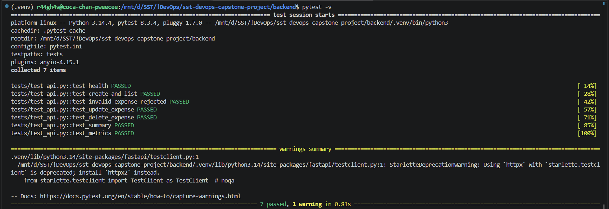 |
| docker compose up --build | 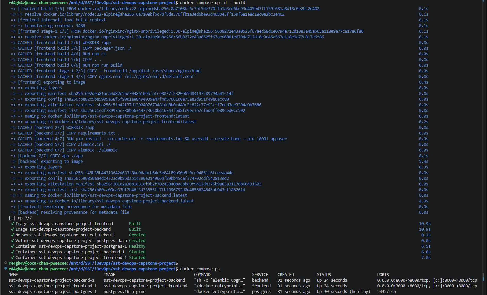 |
| App on http://localhost:3000 | 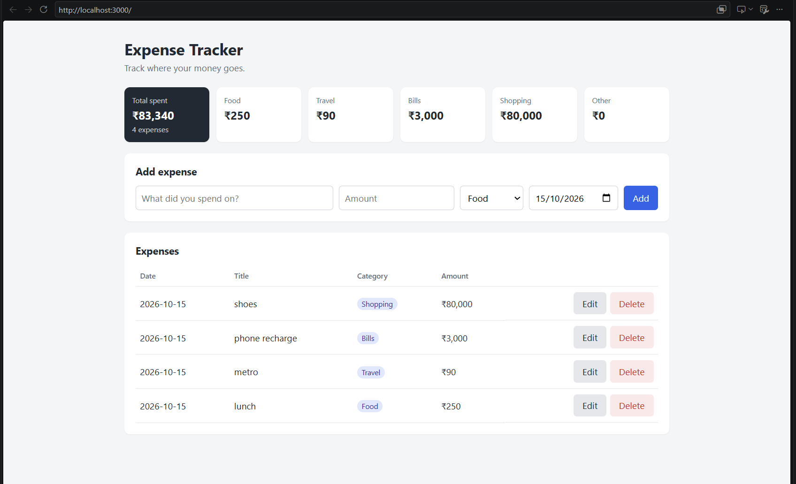 |
| Backend /metrics | 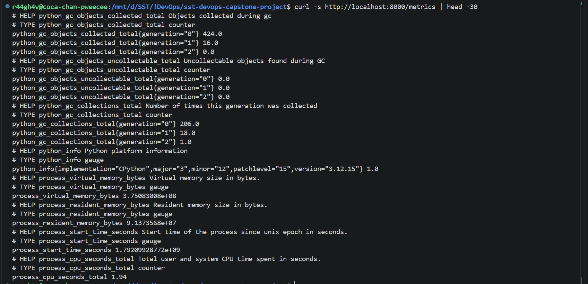 |
| helm list, kubectl get pods, svc, ingress | 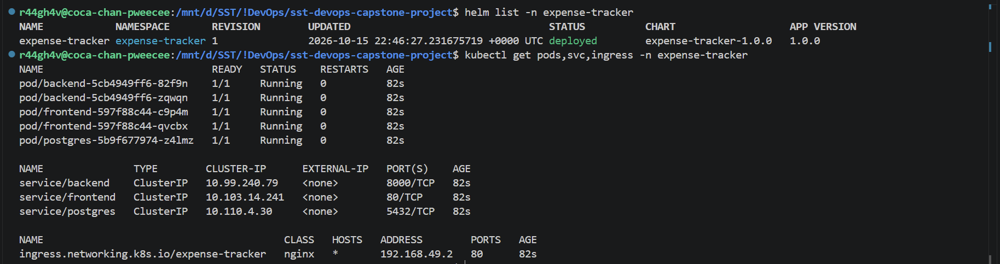 |
| App through the Ingress | 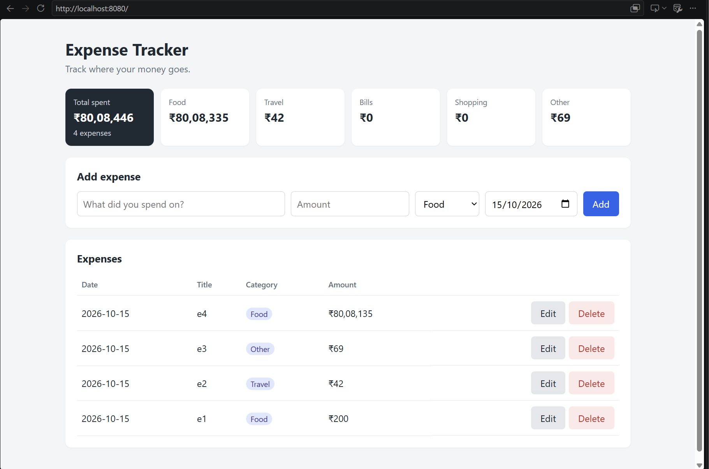 |
| Prometheus targets UP | 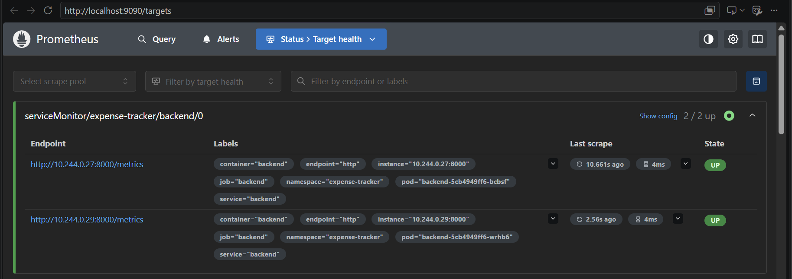 |
| Grafana dashboard | 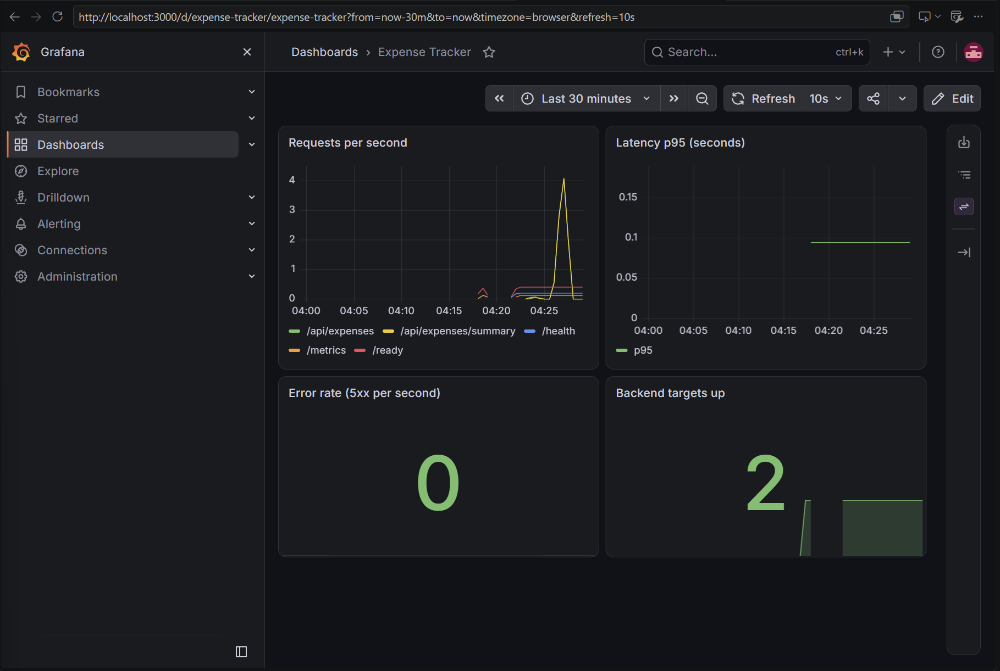 |
| Commit history | 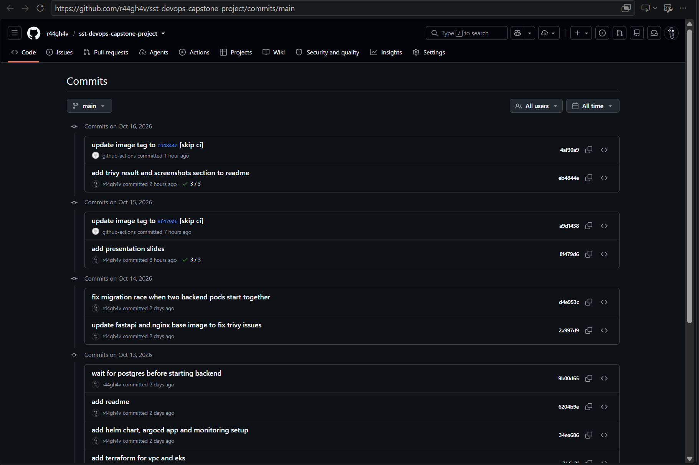 |
| GitHub Actions green run | 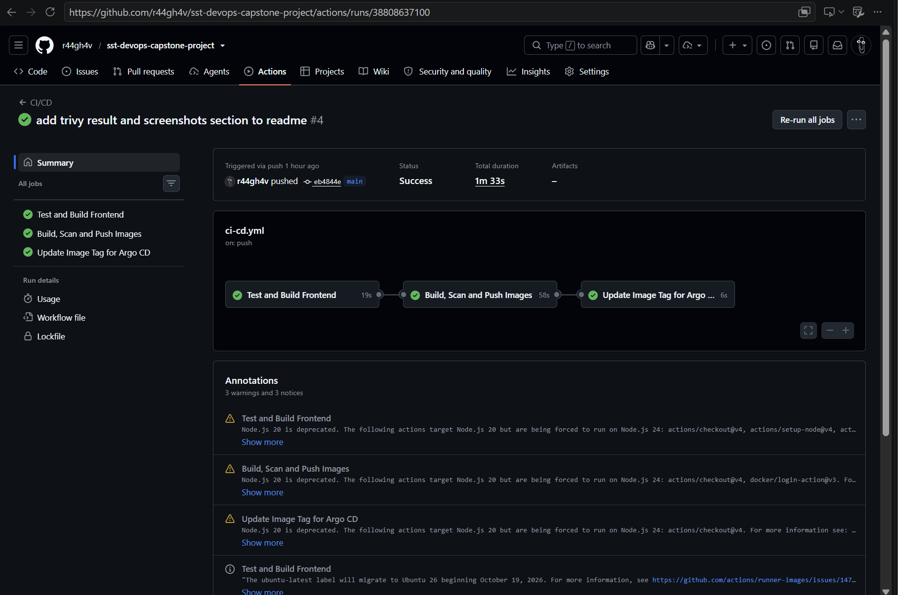 |
| Trivy scan output | 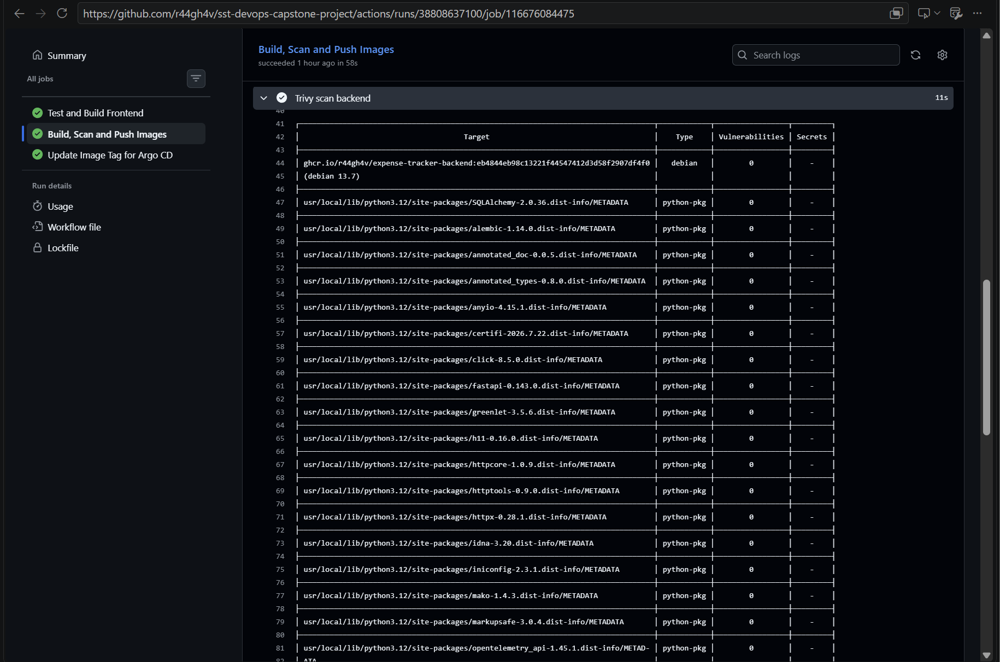 |
| GHCR images with SHA tags | 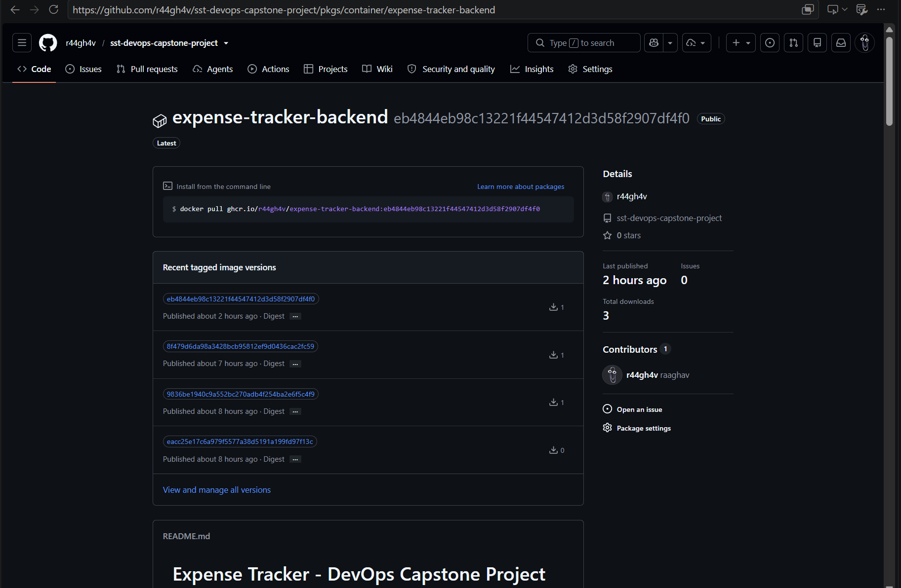 |
| terraform plan | 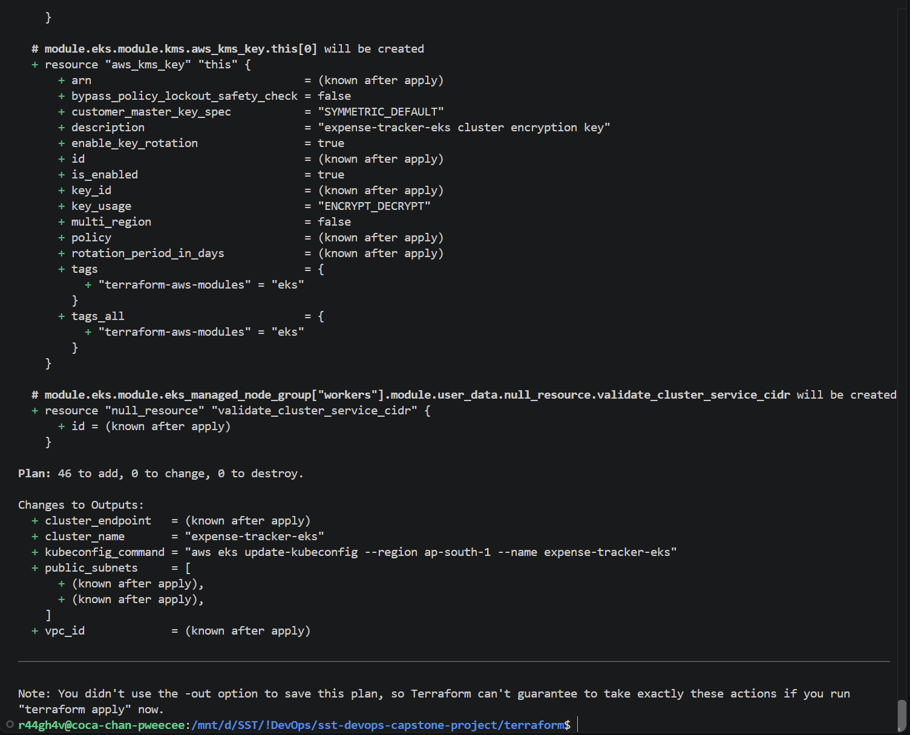 |
| VPC and EKS on AWS (AWS CLI, no Console access) | 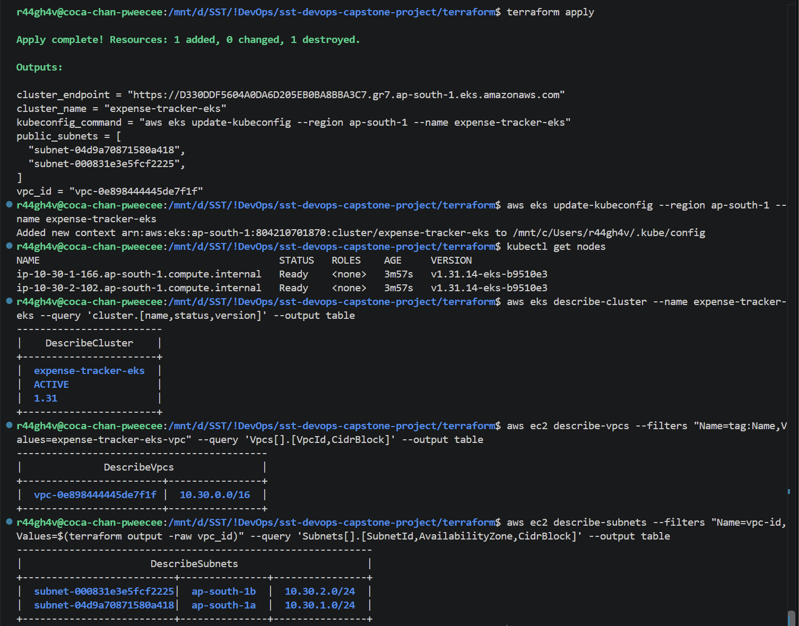 |
| terraform destroy | 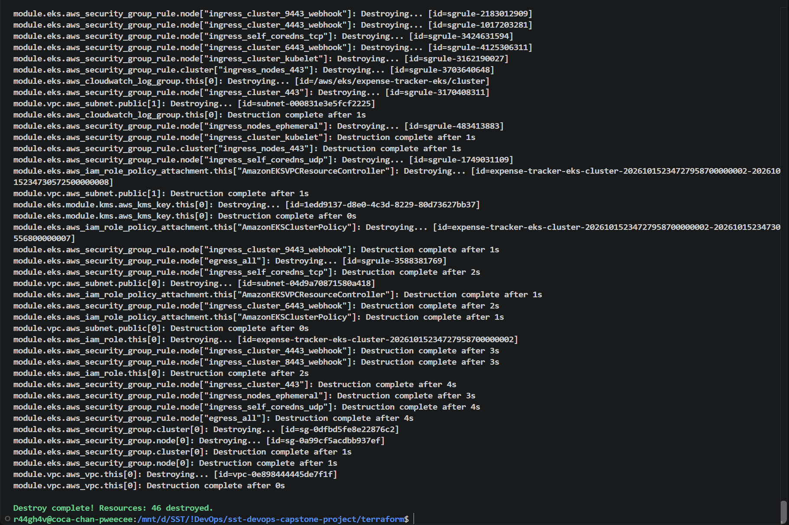 |

## Known Issues and Limitations

- PostgreSQL in Kubernetes uses an `emptyDir` volume, so data is lost if the database pod restarts. A PersistentVolume would be used in production.
- The app runs on a local minikube cluster for the demo. The EKS cluster is created with Terraform to show the AWS setup and is destroyed after the demo to avoid cost.
- The database password is a plain Helm value for simplicity. A real setup would use a secrets manager.
